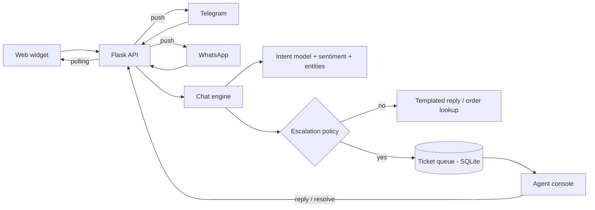

# Customer Support Chatbot with Human Escalation

An NLP-powered support chatbot that answers common customer questions instantly and **hands the conversation to a human agent** when it should. It ships with a web chat widget, an agent console, Telegram and WhatsApp webhook adapters, a REST API, a training pipeline and an automated test suite.

> Demo company: *Nimbus Mart* (e-commerce). Change `COMPANY_NAME` and `data/intents.json` to adapt it to any business.

## Features

| Objective | How it is delivered |
|---|---|
| Natural language processing | TF-IDF (word + character n-grams) with a Logistic Regression intent classifier, order-ID entity extraction, lexicon sentiment analysis |
| Understand and answer queries | 19 intents (orders, payments, refunds, shipping, accounts, warranty, etc.), multi-turn context (asks for an order number, then uses your reply), mock order lookup |
| Integrate into channels | Web widget, Telegram bot, WhatsApp Cloud API, plus a REST API for anything else |
| Seamless human handoff | Rule-based escalation, SQLite ticket queue with priorities, agent console, full transcript passed to the agent, bot goes quiet while a human is active and resumes on resolve |

## Architecture



Message flow: `message -> normalise -> intent + confidence -> sentiment -> escalation check -> reply or ticket`.

## Quick start

```bash
git clone <your-repo-url> && cd customer-support-chatbot
python -m venv .venv && source .venv/bin/activate      # Windows: .venv\Scripts\activate
pip install -r requirements.txt
cp .env.example .env                                    # set AGENT_API_KEY

python scripts/train.py                                 # trains + prints metrics
PYTHONPATH=src python -m chatbot.api                    # Windows: set PYTHONPATH=src
```

Open **http://localhost:8000** for the customer chat and **http://localhost:8000/agent** for the agent console (enter your name and `AGENT_API_KEY`).

No server needed to just try it: `python scripts/chat_cli.py`

Try: `where is my order` -> `ORD-10002` -> `this is useless, I am furious!!!` (escalates to a human).
Sample order ids: `ORD-10001` to `ORD-10004`.

Docker: `docker build -t support-bot . && docker run -p 8000:8000 --env-file .env support-bot`

## Escalation policy (`src/chatbot/escalation.py`)

| Priority | Reason code | Trigger |
|---|---|---|
| 1 | `customer_requested_human` | Customer asks for an agent, manager, "real person" |
| 2 | `sensitive_topic` (high) | Fraud, hacked/stolen, legal action, chargeback, harassment |
| 3 | `very_negative_sentiment` / `frustration_streak` (high) | Strongly angry message, or two upset messages in a row |
| 4 | `complaint` (high) | Complaint intent with sufficient confidence |
| 5 | `bot_unable_to_understand` | Two consecutive low-confidence messages |
| 6 | `repeated_question` | Same intent asked a third time (answer is not helping) |

Each ticket stores the reason, priority, a summary of the last customer messages and the whole transcript, so the agent never asks the customer to repeat themselves. High priority tickets jump the queue; the customer is told their position and estimated wait.

## REST API

| Method | Endpoint | Purpose |
|---|---|---|
| POST | `/api/chat` | `{"message": "...", "session_id": "optional"}` returns reply, intent, confidence, escalation info |
| GET | `/api/messages?session_id=&after=` | Poll for agent/system messages (web widget) |
| GET | `/api/health` | Health check |
| GET | `/api/agent/tickets?status=open` | List tickets (needs `X-API-Key`) |
| GET | `/api/agent/tickets/<id>` | Ticket + full transcript |
| POST | `/api/agent/tickets/<id>/claim` | `{"agent": "Priya"}` |
| POST | `/api/agent/tickets/<id>/reply` | `{"message": "..."}`, pushed to Telegram/WhatsApp, polled by web |
| POST | `/api/agent/tickets/<id>/resolve` | Closes ticket, returns the chat to the bot |
| POST | `/webhook/telegram` | Telegram updates |
| GET/POST | `/webhook/whatsapp` | WhatsApp verification and messages |

```bash
curl -X POST localhost:8000/api/chat -H 'Content-Type: application/json' \
     -d '{"message":"I want to return a product"}'
```

## Channel setup

* **Telegram:** create a bot with @BotFather, set `TELEGRAM_BOT_TOKEN` and `TELEGRAM_WEBHOOK_SECRET`, then call `https://api.telegram.org/bot<TOKEN>/setWebhook?url=<PUBLIC_URL>/webhook/telegram&secret_token=<SECRET>`.
* **WhatsApp:** in the Meta developer console set the callback URL to `<PUBLIC_URL>/webhook/whatsapp`, use the same value as `WHATSAPP_VERIFY_TOKEN`, and set `WHATSAPP_TOKEN` and `WHATSAPP_PHONE_NUMBER_ID`.
* **Local testing:** expose port 8000 with a tunnel (e.g. ngrok).

## Model performance

Measured on the bundled dataset (395 labelled utterances, 19 intents):

| Metric | Result |
|---|---|
| Hold-out accuracy (80/20 stratified split) | **81.0%** |
| Hold-out macro F1 | **0.81** |
| 5-fold cross-validated accuracy / macro F1 | 81.3% / 0.82 |
| Accuracy on answers the bot is confident about (threshold 0.45) | **92.4%**, covering 73% of messages |

Messages below the confidence threshold get a clarifying fallback instead of a possibly wrong answer, and repeated failures escalate to a human. Reproduce with `python scripts/train.py` and `python scripts/evaluate.py` (also prints a threshold trade-off table).

**Important:** the bundled dataset is small and hand-written so the project runs out of the box. Before production use, retrain on your company's real chat/ticket history (see below), which is the single biggest accuracy lever.

## Training on your own data

1. Edit `data/intents.json`: add or change intents, `patterns` (example customer messages, aim for 50+ per intent from real tickets) and `responses`.
2. `python scripts/train.py` then `python scripts/evaluate.py`.
3. Restart the server. Re-train regularly using conversations agents resolved after escalation; these show exactly where the bot is weak.

## Tests

```bash
PYTHONPATH=src python -m pytest -q      # 22 tests: NLP, engine, escalation, API, handoff, webhooks
```
CI runs automatically on GitHub (`.github/workflows/ci.yml`).

## Project structure

```
data/            intents.json (training data + replies), sample_orders.json
src/chatbot/     config, preprocess, nlp_model, sentiment, escalation, engine, store, orders, api
src/chatbot/channels/   telegram + whatsapp adapters, outbound sender
scripts/         train.py, evaluate.py, chat_cli.py
web/             index.html (customer chat), agent.html (agent console)
tests/           pytest suite
docs/            PROJECT_REPORT.md
```

## Production checklist and roadmap

* Set a strong `AGENT_API_KEY`, serve over HTTPS, and put the agent console behind SSO / a proper login.
* Replace `orders.py` with your real order-management API.
* SQLite is fine for a single server; move to PostgreSQL and push notifications (WebSocket/SSE) when you scale.
* Add PII redaction to stored transcripts and a retention policy.
* Upgrade path: sentence-embedding or transformer intent models, multilingual support (Hindi/Bengali), CSAT survey after resolution, analytics dashboard.

## License

MIT
